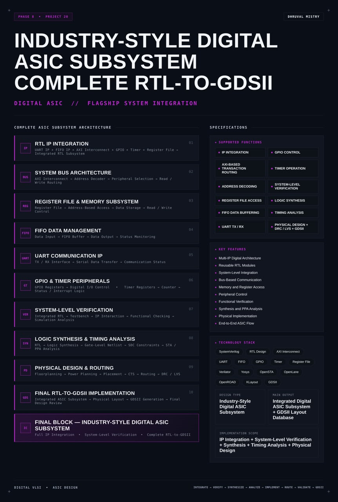
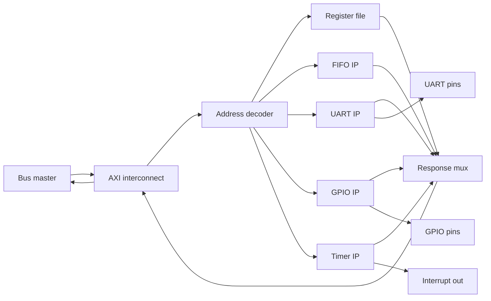
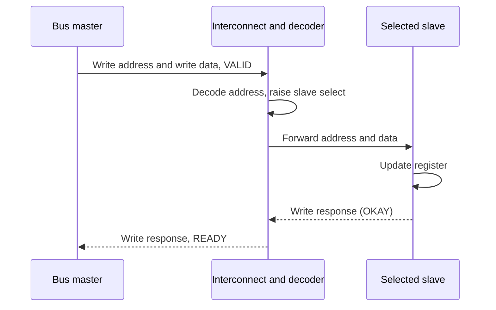
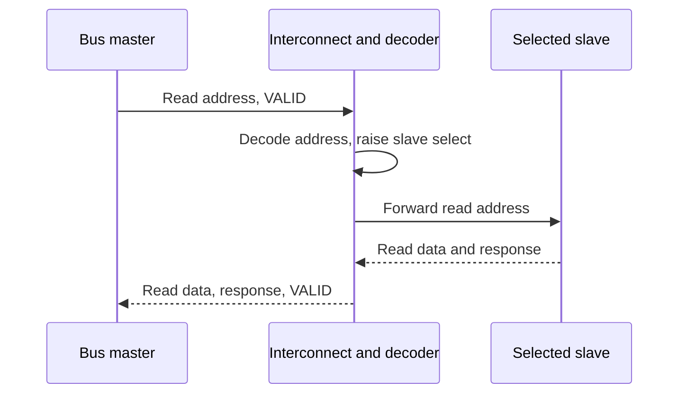
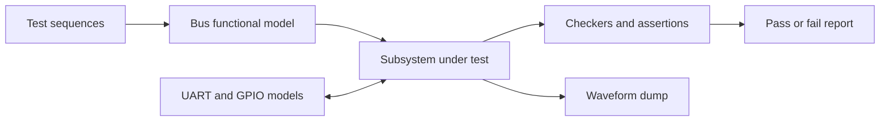
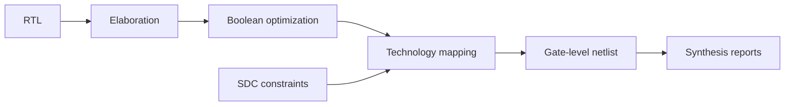
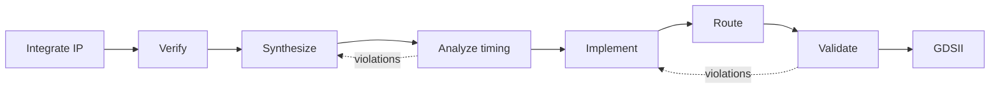

<div align="center">




<b>An integrated digital ASIC subsystem that combines UART, FIFO, GPIO, timer and register file IP behind an AXI interconnect, then takes it through system-level verification, logic synthesis, timing analysis and physical design to a GDSII layout.</b>

<br/>


<br/>

[Overview](#overview) |
[At a Glance](#project-at-a-glance) |
[Background](#background-what-a-subsystem-flow-means) |
[Functions](#supported-functions) |
[Architecture](#architecture) |
[Functional Description](#functional-description) |
[Memory Map](#memory-map-and-address-decoding) |
[Bus Transactions](#bus-transactions) |
[Interface](#interface) |
[Getting Started](#getting-started) |
[Verification](#verification) |
[Synthesis](#logic-synthesis) |
[Timing](#timing-analysis) |
[Physical Design](#physical-design-and-routing) |
[Sign-off](#sign-off-checklist) |
[FAQ](#faq) |
[License](#license)

</div>

---

## Overview

This project builds an **industry-style digital ASIC subsystem** and carries it through the **complete RTL-to-GDSII flow**. It is not a single block. It is a set of reusable **RTL IP blocks** (a UART, a FIFO, a GPIO controller, a timer and a register file) integrated behind an **AXI-based system bus**, with an **address decoder** that routes every transaction to the right peripheral. The same design is then verified at system level, synthesized to a gate-level netlist, timed with static timing analysis and implemented physically down to a **GDSII** layout database.

The idea is to show the whole path that a real digital chip follows, in one repository: **integrate, verify, synthesize, analyze, implement, route, validate, GDSII**. Each stage consumes the output of the previous one and produces something the next one needs: RTL becomes a netlist, the netlist plus constraints becomes a timing report, the netlist becomes a placed and routed layout, and the layout becomes a GDSII file that has passed design rule and layout-versus-schematic checks.

The subsystem is organized the way an SoC peripheral subsystem is organized in industry. A **bus master** issues reads and writes. The **AXI interconnect** carries them. The **address decoder** selects one **slave**. Each slave exposes **memory-mapped registers**, so a read or write to an ordinary address turns into a hardware action: send a byte, change an output pin, start a counter, pop a FIFO entry. The design is **parameterized**, written in a **synthesis-friendly** style, simulated with open-source tools and implemented with an open-source physical design flow.

<table>
<tr>
<td width="50%" valign="top">

#### Objectives
- Integrate UART, FIFO, GPIO, timer and register file IP into one subsystem
- Connect the IP through an AXI interconnect with address-based routing
- Expose every block as memory-mapped registers
- Verify the integrated design at system level, not only block by block
- Synthesize the RTL to a gate-level netlist with SDC constraints
- Analyze setup and hold timing and review PPA
- Run floorplanning, power planning, placement, clock tree synthesis and routing
- Close the flow with DRC, LVS and a final GDSII layout

</td>
<td width="50%" valign="top">

#### Key Features
- Multi-IP digital architecture
- Reusable RTL modules
- System-level integration
- Bus-based communication
- Memory and register access
- Peripheral control
- Functional verification
- Synthesis and PPA analysis
- Physical implementation
- End-to-end ASIC flow

</td>
</tr>
</table>

---

## Project at a Glance

| Attribute | Detail |
|:--|:--|
| **Design type** | Industry-style digital ASIC subsystem |
| **Description language** | SystemVerilog (RTL) |
| **IP blocks** | UART, FIFO, GPIO, timer, register file |
| **System bus** | AXI-based interconnect, single master, multiple slaves |
| **Address decoding** | System address to peripheral selection |
| **Control method** | Memory-mapped registers, read and write access |
| **Clocking** | Single clock domain, one synchronous reset |
| **Main output** | Integrated digital ASIC subsystem and GDSII layout database |
| **Functional verification** | System-level simulation with a bus functional model and checkers |
| **Simulation** | Verilator |
| **Waveform analysis** | GTKWave |
| **Logic synthesis** | Yosys |
| **Constraints** | SDC (clock, input delay, output delay) |
| **Timing analysis** | OpenSTA |
| **Physical design** | OpenLane with OpenROAD |
| **Layout inspection** | KLayout |
| **Physical checks** | DRC and LVS |
| **Final output** | GDSII |
| **Process technology** | TBD (open-source PDK) |
| **Clock frequency** | TBD |
| **Area, power, slack** | TBD (reported by the flow) |
| **License** | MIT |

---

## Background: What a Subsystem Flow Means

A digital chip is rarely written as one large module. It is assembled from **IP blocks**: small, well-defined, reusable pieces such as a serial port, a timer or a memory. Each block is designed and tested on its own, then connected to the others through a standard bus. This is how teams share work and how designs scale.

Three ideas sit behind this project.

**Integration.** Connecting blocks is not trivial. Every block must agree on the bus protocol, the address map, the reset behavior and the clock. Mistakes at the boundaries, such as a wrong address range, a missing response or a mismatched handshake, are among the most common causes of failed chips. That is why the integrated design is verified as a **system**, not only as separate blocks.

**Constraints and timing.** RTL says what the logic does. It does not say how fast it must run. The **SDC constraints** give the target clock, the input and output delays and the exceptions. Synthesis and timing analysis use them to decide whether the design meets its timing, and where it does not.

**Physical reality.** After synthesis the design is still an abstract netlist. Physical design places the cells on a die, builds the power grid, distributes the clock, routes the wires and checks the result against the foundry rules. Only then does the design become a **layout** that can be sent for fabrication, stored in the **GDSII** format.

This repository covers all three, so that the same project shows both the front end (RTL, verification, synthesis, timing) and the back end (floorplan, placement, clock tree, routing, physical verification).

---

## Supported Functions

| # | Function | Description |
|:-:|:--|:--|
| 1 | **IP integration** | UART, FIFO, GPIO, timer and register file connected as one subsystem |
| 2 | **AXI-based transaction routing** | Reads and writes carried from the master to the selected slave |
| 3 | **Address decoding** | Peripheral selection from the system address |
| 4 | **Register file access** | Memory-mapped read and write of control and status registers |
| 5 | **FIFO data buffering** | Data input, buffering, data output and status monitoring |
| 6 | **UART TX and RX** | Serial transmit and receive with communication status |
| 7 | **GPIO control** | Digital input and output registers with interrupt status |
| 8 | **Timer operation** | Counter, reload, enable and overflow status |
| 9 | **System-level verification** | Integrated testbench, IP interaction checks and functional checking |
| 10 | **Logic synthesis** | RTL to a gate-level netlist using SDC constraints |
| 11 | **Timing analysis** | Setup and hold analysis, critical path and slack review |
| 12 | **Physical design and GDSII** | Floorplan, placement, CTS, routing, DRC, LVS and GDSII generation |

---

## Architecture

The subsystem has one **bus master**, one **AXI interconnect with an address decoder**, and five **slave blocks**. The master is driven by a bus functional model in simulation. In a larger chip it would be a processor or a DMA engine.

#### Block diagram

```text
                      +---------------------------------------------------+
                      |            Digital ASIC Subsystem (top)            |
                      |                                                   |
   clk, rst_n ------->|                                                   |
                      |   +-----------+      +------------------------+   |
                      |   |   Bus     |      |    AXI Interconnect    |   |
                      |   |  Master   |=====>|  + Address Decoder     |   |
                      |   | (BFM/CPU) |<=====|  + Response Mux        |   |
                      |   +-----------+      +-----+---+---+---+---+--+   |
                      |                            |   |   |   |   |      |
                      |                  +---------+   |   |   |   +----+ |
                      |                  v             v   v   v        v |
                      |            +----------+  +------+ +-----+ +------+ |
                      |            | Register |  | FIFO | |UART | | GPIO | |
                      |            |  File    |  |  IP  | | IP  | |  IP  | |
                      |            +----------+  +------+ +--+--+ +--+---+ |
                      |                                      |       |     |
                      |                          +-----------+--+    |     |
                      |                          |    Timer IP  |    |     |
                      |                          +--------------+    |     |
                      +--------------------------------------+-------+-----+
                                                             |       |
                                                    uart_tx / rx   gpio_in / gpio_out
                                                    irq_out
```

#### Data flow



#### Block breakdown

| # | Block | Role |
|:-:|:--|:--|
| 01 | **RTL IP integration** | UART, FIFO, AXI interconnect, GPIO, timer and register file assembled into one top level |
| 02 | **System bus architecture** | AXI interconnect, address decoder, peripheral selection, read and write routing |
| 03 | **Register file and memory subsystem** | Register file with address-based access, data storage and read and write control |
| 04 | **FIFO data management** | Data input, FIFO buffer, data output and status monitoring |
| 05 | **UART communication IP** | TX and RX interface, serial data transfer, communication status |
| 06 | **GPIO and timer peripherals** | GPIO registers, digital I/O control, timer registers, counter, status and interrupt logic |
| 07 | **System-level verification** | Integrated RTL, testbench, IP interaction, functional checking, simulation analysis |
| 08 | **Logic synthesis and timing analysis** | RTL to gate-level netlist, SDC constraints, STA and PPA analysis |
| 09 | **Physical design and routing** | Floorplanning, power planning, placement, CTS, routing, DRC and LVS |
| 10 | **Final RTL-to-GDSII implementation** | Integrated subsystem, physical layout, GDSII generation, final design review |

> **Final design block:** industry-style digital ASIC subsystem with full IP integration, system-level verification and a complete RTL-to-GDSII flow.

---

## Functional Description

#### Bus master

The master issues one transaction at a time: an address, a direction, write data and write strobes. It waits for the response before it starts the next one. In simulation the master is a **bus functional model** (BFM) that is driven by test tasks. The same slave-side interface works with a processor in a larger design.

#### AXI interconnect

The interconnect carries the **address, data and response channels** between the master and the slaves using VALID and READY handshakes. A channel transfers data only in a cycle where VALID and READY are both high. The interconnect keeps the master's channels stable until a slave accepts them, and returns the selected slave's response to the master.

#### Address decoder

The decoder compares the upper bits of the transaction address against the configured base and size of every slave. It produces a **one-hot slave select**. If no slave matches, it selects an internal default responder that returns an error response, so a wrong address never hangs the bus.

#### Register file

A small bank of general control and status registers, readable and writable by address. It holds the subsystem identification value, a scratch register for software tests, a global control register and global status flags. It is the simplest slave and the first one used to check that the bus works.

#### FIFO IP

A synchronous FIFO with a write side and a read side, both accessed through registers. Software writes data into the FIFO, reads it back in order, and watches the **status** flags: empty, full and fill level. Writing to a full FIFO and reading from an empty FIFO are handled safely and reported in the status.

#### UART IP

A UART with a **transmitter**, a **receiver** and a **baud rate generator**. Writing a byte to the transmit register starts a serial frame on the TX pin. A byte arriving on the RX pin is assembled, checked and made available in the receive register. A status register reports transmit busy, receive ready and receive error.

#### GPIO IP

A GPIO block with an **input register** that samples the input pins through a synchronizer, an **output register** that drives the output pins, and a **direction** register. It also provides interrupt status for input changes.

#### Timer IP

A timer with a prescaler, a counter, a reload value and an enable bit. When the counter reaches the reload value it sets an **overflow status** flag and can raise the interrupt output. Software clears the flag by writing to the status register.

#### Interrupt output

The UART, GPIO and timer each produce an interrupt request. The register file holds an interrupt enable mask and a pending status. The subsystem has one combined interrupt output.

#### Reset and clocking

The whole subsystem uses **one clock** and **one active-low synchronous reset**, applied to every block. After reset all registers return to their documented defaults, all FIFOs are empty, the UART lines are idle and the timer is stopped.

---

## Memory Map and Address Decoding

#### Subsystem memory map

Every slave owns a window of the address space. Software sees one flat map.

| Slave | Select | Base address | Window size | Access |
|:--|:--|:--|:--|:--|
| Register file | `sel_rf` | TBD | TBD | Read and write |
| FIFO IP | `sel_fifo` | TBD | TBD | Read and write |
| UART IP | `sel_uart` | TBD | TBD | Read and write |
| GPIO IP | `sel_gpio` | TBD | TBD | Read and write |
| Timer IP | `sel_timer` | TBD | TBD | Read and write |
| Unmapped | `sel_err` | Everything else | Remainder | Error response |

The base addresses and window sizes are set by parameters. Windows must not overlap and must be aligned to their size.

#### Decoding rule

```text
sel_X  =  ( (addr & ~(SIZE_X - 1)) == BASE_X )

if no sel_X is true:
    sel_err = 1     -> the interconnect returns an error response (SLVERR or DECERR)
```

Only one select is high for a legal address. The decoder is purely combinational and is checked by an assertion that the selects are one-hot or zero.

#### Register map of the blocks

Offsets are relative to each block's base address. Reset values and bit positions are TBD until the RTL is frozen.

**Register file**

| Offset | Register | Access | Description |
|:--|:--|:--|:--|
| TBD | `ID` | Read only | Subsystem identification value |
| TBD | `SCRATCH` | Read and write | General purpose register for access tests |
| TBD | `CTRL` | Read and write | Global control bits |
| TBD | `STATUS` | Read only | Global status flags |
| TBD | `IRQ_EN` | Read and write | Interrupt enable mask |
| TBD | `IRQ_PEND` | Read only | Interrupt pending flags |

**FIFO IP**

| Offset | Register | Access | Description |
|:--|:--|:--|:--|
| TBD | `FIFO_DATA` | Read and write | Write pushes a word, read pops a word |
| TBD | `FIFO_STATUS` | Read only | Empty, full, level |
| TBD | `FIFO_CTRL` | Read and write | Flush and enable |

**UART IP**

| Offset | Register | Access | Description |
|:--|:--|:--|:--|
| TBD | `UART_TXDATA` | Write only | Byte to transmit |
| TBD | `UART_RXDATA` | Read only | Last received byte |
| TBD | `UART_STATUS` | Read only | TX busy, RX ready, RX error |
| TBD | `UART_BAUD` | Read and write | Baud rate divisor |
| TBD | `UART_CTRL` | Read and write | Enable and parity options |

**GPIO IP**

| Offset | Register | Access | Description |
|:--|:--|:--|:--|
| TBD | `GPIO_DIR` | Read and write | Direction per pin |
| TBD | `GPIO_OUT` | Read and write | Output value |
| TBD | `GPIO_IN` | Read only | Synchronized input value |
| TBD | `GPIO_IRQ_STATUS` | Read and write one to clear | Input change status |

**Timer IP**

| Offset | Register | Access | Description |
|:--|:--|:--|:--|
| TBD | `TIMER_CTRL` | Read and write | Enable and interrupt enable |
| TBD | `TIMER_PRESCALE` | Read and write | Prescaler divisor |
| TBD | `TIMER_RELOAD` | Read and write | Reload value |
| TBD | `TIMER_COUNT` | Read only | Current counter value |
| TBD | `TIMER_STATUS` | Read and write one to clear | Overflow flag |

#### Access rules

- Reads from write-only registers return zero
- Writes to read-only registers are ignored
- Writes use byte strobes, and unselected bytes keep their value
- Status flags that are cleared by software use write one to clear
- Accesses to unmapped addresses return an error response and change nothing

---

## Bus Transactions

#### Write to a register



1. The master presents the write address and the write data with VALID high.
2. The decoder raises exactly one slave select.
3. The slave accepts both, updates the register and returns a response.
4. The interconnect passes the response back and the master completes the transfer.

#### Read from a register



#### Send a byte through the UART

1. Write the baud divisor to `UART_BAUD` and set the enable bit in `UART_CTRL`.
2. Read `UART_STATUS` and check that transmit is not busy.
3. Write the byte to `UART_TXDATA`.
4. The UART frames the byte and shifts it out on the TX pin, start bit first.
5. Poll `UART_STATUS` until transmit busy clears.

#### Move data through the FIFO

1. Read `FIFO_STATUS` and check the full flag is low.
2. Write words to `FIFO_DATA`. Each write pushes one word.
3. Read `FIFO_STATUS` to see the level.
4. Read `FIFO_DATA`. Each read pops the oldest word.
5. Read `FIFO_STATUS` and confirm that empty is high after the last word.

#### Use the timer

1. Write the prescaler and the reload value.
2. Set the enable and interrupt enable bits in `TIMER_CTRL`.
3. Wait for the overflow flag in `TIMER_STATUS` or for the interrupt output.
4. Write one to the overflow bit to clear it.

#### Access to an unmapped address

The decoder raises the error select, the interconnect returns an error response, no slave state changes, and the master sees the error in the response channel.

---

## Interface

#### Ports of the subsystem top level

| Port | Direction | Width | Description |
|:--|:--|:--|:--|
| `clk` | Input | 1 | System clock |
| `rst_n` | Input | 1 | Active-low synchronous reset |
| `m_axi_*` | Input and output | TBD | Master-side AXI channels, driven by the bus master or the testbench |
| `uart_rx` | Input | 1 | UART serial receive |
| `uart_tx` | Output | 1 | UART serial transmit |
| `gpio_in` | Input | `GPIO_WIDTH` | GPIO input pins |
| `gpio_out` | Output | `GPIO_WIDTH` | GPIO output pins |
| `gpio_oe` | Output | `GPIO_WIDTH` | GPIO output enable |
| `irq_out` | Output | 1 | Combined interrupt request |

#### Parameters

| Parameter | Description | Default |
|:--|:--|:--|
| `ADDR_WIDTH` | Address width | TBD |
| `DATA_WIDTH` | Data width | TBD |
| `GPIO_WIDTH` | Number of GPIO pins | TBD |
| `FIFO_DEPTH` | Depth of the FIFO IP | TBD |
| `UART_DIV_WIDTH` | Width of the baud divisor | TBD |
| `TIMER_WIDTH` | Width of the timer counter | TBD |
| `BASE_*`, `SIZE_*` | Base address and window of each slave | TBD |

---

## Repository Structure

```text
industry-style-digital-asic-subsystem-rtl-to-gdsii/
|-- README.md
|-- LICENSE
|-- P20B.png
|-- rtl/
|   |-- top/
|   |   `-- asic_subsystem_top.sv
|   |-- bus/
|   |   |-- axi_interconnect.sv
|   |   |-- addr_decoder.sv
|   |   `-- resp_mux.sv
|   |-- ip/
|   |   |-- reg_file.sv
|   |   |-- sync_fifo.sv
|   |   |-- uart_tx.sv
|   |   |-- uart_rx.sv
|   |   |-- uart_baud_gen.sv
|   |   |-- uart_regs.sv
|   |   |-- gpio.sv
|   |   `-- timer.sv
|   `-- pkg/
|       `-- subsystem_pkg.sv
|-- tb/
|   |-- tb_subsystem.sv
|   |-- axi_bfm.sv
|   |-- checkers.sv
|   `-- tests/
|-- constraints/
|   `-- subsystem.sdc
|-- synth/
|   |-- synth.ys
|   `-- reports/
|-- sta/
|   |-- sta.tcl
|   `-- reports/
|-- pd/
|   |-- config.json
|   |-- pin_order.cfg
|   `-- runs/
|-- signoff/
|   |-- drc/
|   |-- lvs/
|   `-- checklist.md
|-- out/
|   |-- netlist/
|   |-- gds/
|   `-- waves/
`-- Makefile
```

---

## Technology Stack

| Area | Tool or standard |
|:--|:--|
| Design language | SystemVerilog |
| Bus | AXI-based interconnect |
| Simulation | Verilator |
| Waveforms | GTKWave |
| Synthesis | Yosys |
| Constraints | SDC |
| Static timing analysis | OpenSTA |
| Physical design flow | OpenLane |
| Placement and routing engine | OpenROAD |
| Layout viewer | KLayout |
| Final database | GDSII |
| Process design kit | TBD (open-source PDK) |

---

## Getting Started

#### Prerequisites

- Verilator, GTKWave, Yosys
- OpenLane with OpenROAD and OpenSTA, with a PDK installed
- KLayout
- GNU Make

#### 1. Clone

```bash
git clone https://github.com/dhruvalmistry2007/industry-style-digital-asic-subsystem-rtl-to-gdsii.git
cd industry-style-digital-asic-subsystem-rtl-to-gdsii
```

#### 2. Simulate

```bash
make sim
```

#### 3. View waveforms

```bash
make waves
```

#### 4. Synthesize

```bash
make synth
```

#### 5. Timing analysis

```bash
make sta
```

#### 6. Physical design

```bash
make pd
```

#### 7. Open the layout

```bash
make view
```

#### Makefile flow

| Target | Action |
|:--|:--|
| `make lint` | Lint the RTL with Verilator |
| `make sim` | Build and run the system-level testbench |
| `make waves` | Open the waveform in GTKWave |
| `make synth` | Run Yosys and write the gate-level netlist |
| `make sta` | Run OpenSTA with the SDC on the netlist |
| `make pd` | Run the OpenLane flow to GDSII |
| `make signoff` | Collect DRC and LVS reports |
| `make view` | Open the GDSII in KLayout |
| `make clean` | Remove generated files |

---

## Verification

The subsystem is verified at **system level**. The testbench connects a bus functional model to the top level, drives real register accesses and checks what comes out of the pins, not only what is inside the blocks.



#### Testbench components

| Component | Purpose |
|:--|:--|
| **Bus functional model** | Generates read and write transactions with the AXI handshakes |
| **UART model** | Receives frames from `uart_tx` and sends frames into `uart_rx` |
| **GPIO model** | Drives `gpio_in` and observes `gpio_out` |
| **Scoreboard** | Compares expected and observed register values and data |
| **Checkers** | Bus protocol and decoder assertions |
| **Clock and reset generator** | Creates the clock and applies reset |

#### Test plan

| ID | Test | What it checks | Expected result |
|:-:|:--|:--|:--|
| T01 | Reset values | Every register after reset | Documented defaults |
| T02 | Register file access | Write then read of `SCRATCH` and `ID` read | Values match |
| T03 | Address decode | One access per slave window | Only the selected slave responds |
| T04 | Unmapped access | Access outside every window | Error response, no state change |
| T05 | Byte strobes | Partial writes | Only strobed bytes change |
| T06 | FIFO order | Push several words then pop | First in, first out |
| T07 | FIFO empty and full | Pop when empty, push when full | Safe behavior, status flags set |
| T08 | UART transmit | Write a byte | Correct frame on `uart_tx` |
| T09 | UART receive | Frame into `uart_rx` | Correct byte in `UART_RXDATA` |
| T10 | UART errors | Bad stop bit or parity | Error flag set |
| T11 | GPIO output | Write direction and output | Pins follow the registers |
| T12 | GPIO input | Change input pins | `GPIO_IN` follows after the synchronizer |
| T13 | Timer count | Enable timer with a reload value | Overflow flag at the expected count |
| T14 | Interrupt path | Enable and trigger each source | `irq_out` and pending flags correct |
| T15 | Back-to-back traffic | Mixed accesses to all slaves | No lost or crossed transactions |
| T16 | Reset in the middle | Reset during traffic | Clean return to defaults |
| T17 | Integrated scenario | Move data through FIFO, UART and GPIO in one program | Expected output at the pins |

#### Assertions

| Assertion | Property |
|:--|:--|
| Handshake stability | A channel's payload stays stable while VALID is high and READY is low |
| One-hot select | At most one slave select is high |
| Response presence | Every accepted request receives exactly one response |
| No response without request | No response appears when no request is pending |
| FIFO safety | No write when full and no read when empty change the stored data |
| Reset state | Outputs are idle during and right after reset |
| UART line idle | `uart_tx` is high when no frame is sent |

#### Integration checklist

- Every slave is reachable at its base address
- No two windows overlap
- Every slave returns a response for every legal access
- The default responder handles every unmapped address
- Clock and reset reach every block
- Interrupt sources reach the pending register and the output
- Pin-level behavior matches the register-level view

#### Coverage matrix

| Item | Covered by | Status |
|:--|:--|:--|
| Each slave read and write | T02 to T14 | TBD |
| Unmapped access | T04 | TBD |
| Byte strobe patterns | T05 | TBD |
| FIFO empty, full, level | T06, T07 | TBD |
| UART frame types | T08 to T10 | TBD |
| GPIO directions | T11, T12 | TBD |
| Timer overflow | T13 | TBD |
| Interrupt sources | T14 | TBD |
| Line and toggle coverage | All | TBD |

#### Waveform analysis checklist

- Reset is released cleanly and registers hold their defaults
- AXI channels show VALID and READY handshakes in order
- Exactly one slave select is high during each access
- The response arrives after the slave completes the access
- The UART frame has a start bit, data bits, optional parity and a stop bit
- The timer count rises, reaches the reload value and sets overflow
- The FIFO level changes by one on every push and pop

---

## Logic Synthesis

Synthesis turns the RTL into a **gate-level netlist** built from standard cells of the target library.



#### Steps

1. **Read and elaborate.** Read the SystemVerilog sources and build the design hierarchy.
2. **Optimize.** Simplify the logic, share common terms and remove unused logic.
3. **Map flip-flops.** Map registers to the library flip-flops.
4. **Map logic.** Map the remaining logic to the standard cell library.
5. **Write the netlist.** Write the gate-level netlist and the reports.

```bash
yosys -c synth/synth.ys
```

#### Results

| Metric | Result |
|:--|:--|
| Cell count | TBD |
| Cell area | TBD |
| Flip-flop count | TBD |
| Estimated power | TBD |

Results are filled in from the generated reports after a run. No figures are stated before that.

#### Notes

- Use synchronous resets and a single clock to keep the flow simple
- Avoid latches and unintended combinational loops, and check the lint report
- Re-run the system-level simulation on the gate-level netlist when the cell models are available

---

## Timing Analysis

**Static timing analysis (STA)** checks every timing path in the netlist against the constraints without needing simulation vectors.

#### SDC constraints

```tcl
create_clock -name clk -period <TBD> [get_ports clk]
set_input_delay  -clock clk <TBD> [all_inputs]
set_output_delay -clock clk <TBD> [all_outputs]
set_clock_uncertainty <TBD> [get_clocks clk]
set_false_path -from [get_ports rst_n]
```

#### What is checked

| Check | Meaning |
|:--|:--|
| **Setup** | Data arrives before the capturing clock edge, minus the setup time |
| **Hold** | Data stays stable after the capturing clock edge for the hold time |
| **Slack** | Required time minus arrival time, negative slack is a violation |
| **Critical path** | The path with the worst setup slack |
| **Clock skew** | Difference in clock arrival between launching and capturing flip-flops |

#### Flow

```bash
sta sta/sta.tcl
```

1. Read the netlist, the libraries and the SDC.
2. Report setup and hold slack for all paths.
3. Inspect the critical path and the worst hold path.
4. If there are violations, adjust the constraints, the RTL or the physical flow and run again.
5. Repeat after placement and after routing, using the extracted parasitics.

#### PPA review

| Metric | Source | Value |
|:--|:--|:--|
| Performance (worst slack, achieved frequency) | STA reports | TBD |
| Power | Power report | TBD |
| Area | Synthesis and layout reports | TBD |

---

## Physical Design and Routing

Physical design turns the netlist into a layout on silicon.


| Stage | What happens |
|:--|:--|
| **Floorplanning** | Choose die and core area, utilization and aspect ratio, and place the I/O pins |
| **Power planning** | Build power rings, stripes and the power grid so every cell is supplied |
| **Placement** | Place standard cells, then legalize and optimize wire length and timing |
| **Clock tree synthesis** | Insert clock buffers so the clock reaches every flip-flop with low skew |
| **Global routing** | Plan wire paths and estimate congestion |
| **Detailed routing** | Draw the actual metal wires and vias |
| **Parasitic extraction** | Extract resistance and capacitance for the final timing check |
| **DRC** | Check the layout against the foundry design rules |
| **LVS** | Check that the layout matches the netlist |
| **GDSII generation** | Write the final layout database |

#### Configuration

```json
{
  "DESIGN_NAME": "asic_subsystem_top",
  "VERILOG_FILES": "dir::rtl/**/*.sv",
  "CLOCK_PORT": "clk",
  "CLOCK_PERIOD": "TBD",
  "FP_CORE_UTIL": "TBD",
  "PL_TARGET_DENSITY": "TBD"
}
```

#### Run

```bash
make pd
```

#### Review points

- Utilization and density suit the available area
- The power grid has no unconnected or starved regions
- Congestion is acceptable after global routing
- Clock skew is within the target
- Timing is met after routing with extracted parasitics
- DRC and LVS are clean

---

## Sign-off Checklist

| Item | Check | Status |
|:--|:--|:--|
| RTL lint | No errors, warnings reviewed | TBD |
| System-level simulation | All tests pass | TBD |
| Coverage | Targets reviewed | TBD |
| Synthesis | No latches, no unmapped cells | TBD |
| Setup timing | Worst slack not negative | TBD |
| Hold timing | Worst slack not negative | TBD |
| Clock tree | Skew reviewed | TBD |
| Routing | No open nets, no shorts | TBD |
| DRC | Zero violations | TBD |
| LVS | Layout matches netlist | TBD |
| Antenna | Violations reviewed | TBD |
| GDSII | File generated and opened in KLayout | TBD |

---

## Design Considerations

- **One clock domain** keeps timing closure and clock tree synthesis simple.
- **Synchronous reset** is used in every block, so reset timing is analyzed like any other path.
- **Registered outputs** on the slaves keep output delay paths short.
- **Input synchronizers** on `uart_rx` and `gpio_in` protect against metastability on asynchronous pins.
- **Default responder** keeps the bus alive on a bad address.
- **Parameterization** lets the same RTL serve different widths and depths.
- **Constraints first.** A timing result is only meaningful when the SDC reflects the real target.

#### Current limitations

- Single master only, no arbitration
- No burst transfers, no out-of-order transactions
- Single clock domain, no clock domain crossing
- Open-source PDK and flow, not a commercial sign-off flow
- No power intent (UPF), no scan insertion or test logic
- Results depend on the chosen PDK, library and flow version

---

## Applications

- Peripheral subsystem of a microcontroller-class SoC
- Teaching reference for a full digital ASIC flow
- Starting point for an IoT or sensor controller
- Test chip for IP blocks
- Base for adding a processor, memory and more peripherals

---

## Customization

#### Add a peripheral

1. Write the slave with the same bus interface.
2. Add its base address and window to the parameters.
3. Add its select to the decoder and its response to the response mux.
4. Add tests and assertions.
5. Re-run synthesis, STA and physical design.

#### Change the address map

Edit the `BASE_*` and `SIZE_*` parameters. Keep windows aligned and non-overlapping, and update the tests.

#### Change the target clock

Edit the clock period in the SDC and in the physical design configuration, then re-run synthesis, STA and the physical flow.

---

## Troubleshooting

| Symptom | Likely cause | Fix |
|:--|:--|:--|
| Simulation hangs | A slave never returns a response | Check the response mux and the default responder |
| Read returns zero | Wrong offset or write-only register | Check the register map |
| Two slaves respond | Overlapping windows | Fix the base and size parameters |
| UART frame wrong | Baud divisor mismatch | Check `UART_BAUD` against the clock |
| Timer never overflows | Not enabled or reload too large | Check `TIMER_CTRL` and `TIMER_RELOAD` |
| Latch in synthesis | Incomplete assignment in combinational logic | Assign a default in every branch |
| Negative setup slack | Clock too fast or long path | Relax the clock, restructure the logic or re-run optimization |
| Negative hold slack | Short path or high skew | Let the flow insert hold buffers or review the clock tree |
| Routing congestion | Utilization too high | Lower utilization or change the floorplan |
| DRC violations | Routing or PDK setup issue | Read the DRC report and check the PDK configuration |
| LVS mismatch | Missing connection or wrong netlist | Compare the layout netlist with the synthesized netlist |

---

## FAQ

**What does RTL-to-GDSII mean?**
The full path from the hardware description (RTL) to the final layout file (GDSII) that is sent to a foundry.

**Is this a processor?**
No. It is a peripheral subsystem. A processor can be added as the bus master.

**Why an AXI-based bus?**
It is a standard interface, so blocks can be added or replaced without changing the rest.

**Why verify at system level?**
Many failures happen at the connections between blocks. System-level tests exercise the real decoder, the bus and the pins together.

**Why are many values TBD?**
Area, power, slack and frequency depend on the PDK, the library and the tool version. They are filled in from real reports after a run.

**Which tools are used?**
Verilator, GTKWave, Yosys, OpenSTA, OpenLane, OpenROAD and KLayout.

**Is the layout ready for fabrication?**
Only after clean DRC, LVS and timing sign-off with a PDK and flow suitable for the intended foundry.

**Can I change the PDK?**
Yes. Change the PDK in the physical design configuration and re-run the flow, then review every report again.

---

## Learning Outcomes

- Integrating several IP blocks behind a bus
- Designing a memory map and an address decoder
- Building a system-level testbench with a bus functional model
- Writing SDC constraints and reading timing reports
- Understanding setup, hold, slack and critical paths
- Running floorplanning, placement, CTS and routing
- Interpreting DRC and LVS results
- Producing and inspecting a GDSII layout

---

## Design Flow



`RTL -> Verification -> Synthesis -> Timing Analysis -> Physical Design -> Routing -> DRC and LVS -> GDSII`

---

## Future Work

- Add a processor as the bus master
- Add on-chip memory and a memory controller
- Add DMA and more peripherals such as SPI and I2C
- Add multiple clock domains with safe crossings
- Add scan insertion and power intent
- Add gate-level simulation with back-annotated timing
- Add a UVM-based verification environment
- Add continuous integration that runs the full flow

---

## Contributing

Contributions are welcome. Fork the repository, create a branch, make your change with tests and updated reports, and open a pull request with a clear description.

---

## References

- [Verilator](https://www.veripool.org/verilator/): open-source SystemVerilog simulator
- [GTKWave](https://gtkwave.sourceforge.net/): waveform viewer
- [Yosys Open SYnthesis Suite](https://yosyshq.net/yosys/): open-source RTL synthesis framework
- [OpenLane](https://github.com/The-OpenROAD-Project/OpenLane): open-source RTL-to-GDSII flow
- [OpenROAD](https://theopenroadproject.org/): open-source physical design tools
- [OpenSTA](https://github.com/The-OpenROAD-Project/OpenSTA): open-source static timing analyzer
- [KLayout](https://www.klayout.de/): layout viewer and editor
- Arm AMBA AXI and ACE Protocol Specification
- IEEE Std 1800: SystemVerilog language standard

---

## License

This project is licensed under the **MIT License**. See the [LICENSE](LICENSE) file for details.

---

## Author

<div align="center">

**Dhruval Mistry**

[](https://github.com/dhruvalmistry2007)

<br/>


</div>
